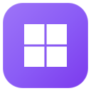

<div align="left">
  <table>
    <tr>
      <td>
        
      </td>
      <td>
        <h1 style="color: #7C86FF; margin: 0; font-size: 32px;">Pulsar Windows</h1>
        <p style="color: oklch(90% 0 0); font-size: 14px; margin: 5px 0;">Winboat superpowered for Pulsar OS.<br>
        Run Windows apps on 🐧 Linux with ✨ seamless integration</p>
      </td>
    </tr>
  </table>
</div>

## Screenshots

<div align="center">
  
  
  
</div>

## Work in Progress and (c)

Pulsar Windows is a derivative of Winboat. It may have more problems than Winboat, even though it is designed to be almost out-of-the-box.

## Features

- **Elegant Interface**: Sleek and intuitive interface that seamlessly integrates Windows into your Linux desktop environment, making it feel like a native experience
- **Automated Installs**: Simple installation process through our interface - pick your preferences & specs and let us handle the rest
- **Run Any App**: If it runs on Windows, it can run on Pulsar Windows. Enjoy the full range of Windows applications as native OS-level windows in your Linux environment
- **Full Windows Desktop**: Access the complete Windows desktop experience when you need it, or run individual apps seamlessly integrated into your Linux workflow
- **Filesystem Integration**: Your home directory is mounted in Windows, allowing easy file sharing between the two systems without any hassle
- **Apps Integration**: Windows apps as your desktop apps, right in your DE
- **And many more**: Smartcard passthrough, resource monitoring, and more features being added regularly

## How Does It Work?

Pulsar Windows is an Electron app which allows you to run Windows apps on Linux using a containerized approach. Windows runs as a VM inside a Docker/Podman container, we communicate with it using the [Pulsar Windows Guest Server](https://github.com/Inled-Pulsar-OS/pulsar-windows/tree/main/guest_server) to retrieve data we need from Windows. For compositing applications as native OS-level windows, we use FreeRDP together with Windows's RemoteApp protocol.

## Prerequisites

Before running Pulsar Windows, ensure your system meets the following requirements:

- **RAM**: At least 4 GB of RAM
- **CPU**: At least 2 CPU threads
- **Storage**: At least 32 GB free space on the drive your selected install folder corresponds to
- **Virtualization**: KVM enabled in BIOS/UEFI
    - [How to enable virtualization](https://duckduckgo.com/?t=h_&q=how+to+enable+virtualization+in+%3Cmotherboard+brand%3E+bios&ia=web)
- **In case of Docker:**
  - **Docker**: Required for containerization
      - [Installation Guide](https://docs.docker.com/engine/install/)
      - **⚠️ NOTE:** Docker Desktop is **not** supported, you will run into issues if you use it
  - **Docker Compose v2**: Required for compatibility with docker-compose.yml files
      - [Installation Guide](https://docs.docker.com/compose/install/#plugin-linux-only)
  - **Docker User Group**: Add your user to the `docker` group
      - [Setup Instructions](https://docs.docker.com/engine/install/linux-postinstall/#manage-docker-as-a-non-root-user)
- **In case of Podman:**
  - **Podman**: Required for containerization
      - [Installation Guide](https://podman.io/docs/installation#installing-on-linux)
      - On Debian/Ubuntu and forks, the Podman version installed with `apt install` could be too old. Make sure you have **Version 4.x.x** or higher to ensure the installation completes successfully.
  - **Podman Compose**: Required for compatibility with podman-compose.yml files
      - [Installation Guide](https://github.com/containers/podman-compose?tab=readme-ov-file#installation)
- **FreeRDP**: Required for remote desktop connection (Please make sure you have **Version 3.x.x** with sound support included)
    - [Installation Guide](https://github.com/FreeRDP/FreeRDP/wiki/PreBuilds)
- [OPTIONAL] **Kernel Modules**: The `iptables` / `nftables` kernel modules can be loaded for better network performance, but this is not obligatory in newer versions of Pulsar Windows
    - [Module loading instructions](https://rentry.org/rmfq2e5e)

## Downloading

You can download the latest Linux builds under the [Releases](https://github.com/Inled-Pulsar-OS/pulsar-windows/releases) tab. We currently offer four variants:

- **AppImage:** A popular & portable app format which should run fine on most distributions
- **Unpacked:** The raw unpacked files, simply run the executable (`linux-unpacked/winboat`)
- **.deb:** The intended format for Debian based distributions
- **.rpm:** The intended format for Fedora based distributions
- **Nix (Nixpkgs)**
    1. Add the winboat package to your config (ensure using nixpkgs-unstable)
    using `environment.systemPackages = [pkgs.winboat];` or `home.packages = [pkgs.winboat];` if using home manager.
    2. Add the following lines to your nix configuration
    ```nix
    virtualisation.docker.enable = true;
    users.users.{yourUser}.extraGroups = ["docker"];
    ```
## Known Issues About Container Runtimes

- Docker Desktop is **unsupported** for now
- USB passthrough via Podman is currently **unsupported**

## Building Pulsar Windows

- For building you need to have Bun and Go installed on your system
- Clone the repo
- Install the dependencies (`bun i`)
- Build the app and the guest server using `bun run build:linux-gs`
- You can now find the built app under `dist` with an AppImage and an Unpacked variant

## Running Pulsar Windows in development mode

- Make sure you meet the [prerequisites](#prerequisites)
- Additionally, for development you need to have Bun and Go installed on your system
- Clone the repo
- Install the dependencies (`bun i`)
- Build the guest server (`bun run build:gs`)
- Run the app (`bun run dev`)
